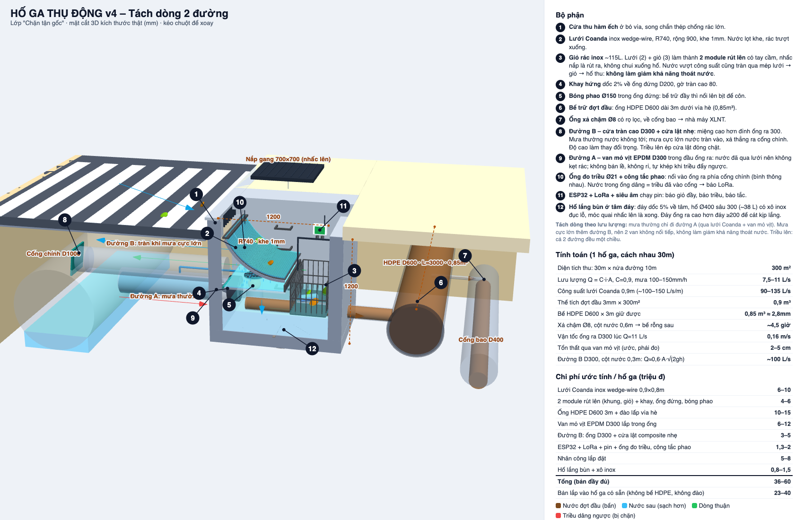

# Hố Ga Thụ Động v4: chặn rác, nước bẩn đợt đầu và triều ngược ngay tại hố ga

Xử lý **ngay tại hố ga hàm ếch** ven đường, trước khi nước xuống cống chính rồi ra biển. Dùng 3 nguyên lý cơ khí đã được chứng minh, **không cần điện**. Hộp Cửa Xả Thông Minh ([FIRST_FLUSH.md](FIRST_FLUSH.md)) vẫn là lớp cuối ở cửa xả.

Mô hình 3D xoay được: tải [hoga3d_v4.html](hoga3d_v4.html) rồi mở bằng Chrome. Video mô phỏng toàn bộ quá trình (v4): [tải video](https://github.com/CaoLP/Sample-Projects/releases/tag/hoga-mophong-v4), bản tương tác [hoga_mophong.html](hoga_mophong.html). Các bản cũ: [v3](hoga3d_v3.png), [v2 dùng van Tesla](hoga3d_v2.png).

**Lịch sử thay đổi**
- v3: bỏ van Tesla làm van chính (chỉ cản bớt, vẫn rò ngược, dễ tắc rác), thay bằng lưới Coanda + van mỏ vịt + cửa lật nối tiếp.
- **v4: tách dòng 2 đường.** v3 đặt van mỏ vịt và cửa lật nối tiếp trên 1 ống, mưa cực lớn có thể bị giảm khả năng thoát. v4 tách thành đường A (mưa thường) và đường B (tràn khi mưa cực lớn), mỗi đường có van một chiều riêng. Thêm module rút lên và hố bùn. Xem mục 1b.

## 1. Thiết kế (kích thước thật, mm)
| # | Bộ phận | Thông số |
|---|---|---|
| 1 | Cửa thu hàm ếch ở bó vỉa | Khe cao 220, song chắn thép chống rác lớn |
| 2 | Lưới Coanda | Inox wedge-wire, bán kính cong 740, rộng 900, khe 1mm |
| 3 | Giỏ rác | Inox 400×380×760 (~115L), có quai, nhấc qua nắp gang 700×700 |
| 4 | Khay hứng | Dốc 2% về ống đứng D200, gờ tràn cao 80 |
| 5 | Ống đứng + bóng phao | D200, bóng nhựa rỗng Ø150, đế côn cao su để bịt kín |
| 6 | Bể trữ đợt đầu | Ống HDPE D600 dài 3m, chôn dưới vỉa hè |
| 7 | Ống xả chậm | Ø8 có rọ lọc, nối cống bao (cống thu gom nước thải) |
| 8 | Đường B: cửa tràn cao + cửa lật nhẹ | Ống D300, miệng cao hơn đỉnh ống ra 300; cửa lật composite ở đầu ra vào cống chính (kiểm tra qua hố thăm cống chính) |
| 9 | Đường A: van mỏ vịt cao su EPDM | D300, lắp trong đầu ống ra, mỏ cong có gân cứng chống lật, hướng về cống chính D1000 |
| 10 | Ống đo triều + công tắc phao | Ống PVC Ø21 nối vào ống ra phía sau van mỏ vịt, dẫn về ngăn van |
| 11 | Cảm biến (tuỳ chọn) | ESP32 + LoRa + siêu âm + công tắc phao, pin |
| 12 | Hố bùn | Đáy hố thu dốc về hố Ø240 sâu 140 ở giữa |
| — | Module rút lên | Khung lưới Coanda và giỏ rác là 2 module inox/composite có tay cầm, rút qua nắp gang |
| — | Thân hố ga | BTCT lòng 1200×1000, sâu 1200, thành 150 |

**Đường tràn an toàn:** khi mưa vượt công suất, nước cùng rác tràn qua mép dưới lưới → giỏ → hố thu → ống ra. Hố ga không bao giờ thoát nước kém hơn hố ga thường.

## 1b. Chống triều + tách dòng 2 đường

| | Van Tesla | Cửa lật | Van mỏ vịt cao su |
|---|---|---|---|
| Đóng kín | Không, chỉ cản bớt, vẫn rò | Kín nếu không kẹt rác | Kín nếu không kẹt rác |
| Bộ phận chuyển động | Không | Bản lề | Không (môi cao su đàn hồi) |
| Chênh mực để mở | Không cần | Cửa nhẹ: vài cm | Vài cm |
| Hỏng thường gặp | Tắc kênh hẹp | Rác kẹt khe, bản lề kẹt | Rác kẹt giữa 2 môi, cao su lão hoá |

Cả cửa lật và mỏ vịt đều hỏng chủ yếu vì **rác kẹt**, nên đặt **lưới Coanda lọc rác trước** để bảo vệ van.

**Tách dòng theo lưu lượng:**
- **Đường A (mưa thường, phần lớn thời gian):** lưới Coanda → khay/giỏ → hố thu → **van mỏ vịt D300** → cống chính. Nước đã qua lưới nên không kẹt rác vào môi van.
- **Đường B (mưa cực lớn):** cửa tràn D300 đặt **cao hơn đỉnh ống ra 300**. Mưa thường nước không lên tới, không chảy qua. Khi nước trong hố dâng cao, nước tràn vào đường B và xả thẳng ra cống chính qua **cửa lật composite nhẹ**.
- **Không cần đối trọng:** chính độ cao của cửa tràn quyết định lúc nào đường B làm việc. Cửa lật chỉ cần nhẹ để chặn triều. Bỏ đối trọng → rẻ hơn, không phải chỉnh, ít kẹt, ít rỉ.
- **Khi triều lên:** đường A có van mỏ vịt chặn, đường B có cửa lật bị nước ngoài ép chặt → cả 2 đường đều một chiều.
- So với v3 (2 van nối tiếp): mỗi đường chỉ có 1 van nên ít tổn thất, nhưng mỗi đường chỉ còn 1 lớp chặn. Đổi lại an toàn chống ngập là ưu tiên số 1.

**Ống đo triều (bình thông nhau):** ống Ø21 nối vào ống ra phía cống chính. Triều dâng vào cống thì nước trong ống dâng theo, nâng công tắc phao → ESP32 gửi LoRa → hộp báo động trên trụ điện gần đó chuyển **vàng sớm**, trước khi nước lên mặt đường.

**Tuỳ chọn – phao khoá mùi mùa khô:** bóng nhựa trong lồng nằm trên miệng thu khi hố khô để chặn mùi, có nước thì nổi lên mở. Chỉ dùng để **chặn mùi**, không chống triều (triều dâng vào hố sẽ làm phao nổi, mở ra). Đặt đế cao hơn đáy để cát không đọng làm hở.

**Đã cân nhắc và không dùng:**
- Phao nổi bịt ống ra để chống triều: mưa to nước dâng xuôi chiều cũng làm phao nổi, bịt ống → ngập.
- Rãnh Tesla micro trên van mỏ vịt để giảm búa nước: cống thoát nước mưa chảy không áp, vận tốc thấp nên búa nước nhỏ; rãnh vài mm gần như không có tác dụng, khó gia công trên cao su, dễ bám bùn. Chống lật mỏ vịt bằng loại mỏ cong có gân cứng.
- Van Tesla làm van chính: vẫn rò ngược, dễ tắc. Chỉ giữ trong thí nghiệm so sánh.

**Tính mới (nói đúng mức):** lưới Coanda cho cửa thu vỉa hè đã có sản phẩm ở nước ngoài; ở VN đã có hố ga ngăn mùi dùng song chắn + cửa lật. Điểm mới là **cách tích hợp** cho hố ga hàm ếch: lưới Coanda tự làm sạch + tách dòng 2 đường + van một chiều trên mỗi đường + giữ nước bẩn đợt đầu + ống đo triều báo sớm cho trụ cảnh báo. Không ghi "chưa có trên thị trường".

## 2. Tính toán sơ bộ (1 hố ga, khoảng cách 30m)
| Hạng mục | Công thức | Kết quả |
|---|---|---|
| Diện tích thu | 30m × nửa mặt đường 10m | 300 m² |
| Lưu lượng đỉnh | Q = C·i·A/3600, C=0,9, i = 100–150 mm/h | 7,5–11 L/s |
| Công suất lưới Coanda | ~100–150 L/s cho mỗi mét bề rộng (số liệu nhà sản xuất), rộng 0,9m | 90–135 L/s, dư ~10 lần |
| Thể tích đợt đầu cần giữ | 3mm mưa × 300m² | 0,9 m³ |
| Bể HDPE D600 dài 3m | π·0,3²·3 | 0,85 m³ ≈ 2,8mm mưa |
| Thời gian bể tự rỗng | lỗ Ø8, Cd=0,6, cột nước 0,6m | ~4,5 giờ (Ø5 thì ~12 giờ và dễ tắc) |
| Vận tốc ống ra | 11 L/s qua D300 | 0,16 m/s |
| Tổn thất qua van mỏ vịt (đường A) | ước tính, **phải đo** | ~2–5 cm cột nước |
| Khả năng đường B | D300, cột nước 0,3 m: Q ≈ 0,6·A·√(2gh) | ~100 L/s, gấp ~9 lần lưu lượng đỉnh (chưa tính ma sát ống) |

- Vì sao chọn 3mm: các nghiên cứu "first-flush" cho thấy phần nước đầu cơn mưa chứa tỉ lệ chất bẩn cao hơn hẳn phần sau. Con số chính xác khác nhau theo từng tuyến đường, **phải đo**: lấy mẫu mỗi 5 phút trong 3–5 cơn mưa, đo độ đục/TSS để vẽ đường cong.
- Hố ga thường chỉ chứa được ~0,1 m³ (≈0,3mm mưa), quá ít. Vì vậy bản v2 thêm **ống trữ HDPE dưới vỉa hè**.

## 3. Chi phí ước tính (1 hố ga, triệu đồng)
| Hạng mục | Chi phí |
|---|---|
| Lưới Coanda inox wedge-wire 0,9×0,8m | 6–10 |
| 2 module rút lên (khung lưới, giỏ) + khay, ống đứng, bóng phao | 4–6 |
| Ống HDPE D600 3m + đào lấp, hoàn trả vỉa hè | 10–15 |
| Van mỏ vịt cao su EPDM D300 lắp trong ống | 6–12 |
| Đường B: ống D300 + cửa lật composite nhẹ | 3–5 |
| ESP32 + LoRa + pin + ống đo triều, công tắc phao | 1,3–2 |
| Nhân công lắp đặt | 5–8 |
| **Tổng (bản đầy đủ)** | **35–58** |

- **Bản lắp vào hố ga có sẵn** (module lưới + giỏ, van mỏ vịt, đường B, cảm biến; không bể HDPE, không đào vỉa hè): ~22–39 triệu. Dễ áp dụng thực tế nhất.
- Bản tối thiểu chỉ có module lưới Coanda + giỏ rác: ~12–18 triệu.
- Khoảng giá rộng chủ yếu vì van mỏ vịt EPDM D300 chưa có báo giá.
- Mô hình demo tỉ lệ 1:5 (mica, in 3D, ống PVC): ~1,5–2 triệu.
- Giá tham khảo, cần lấy báo giá thật (đặc biệt tấm wedge-wire).

## 4. Tính khả thi
**Thuận lợi**
- Không cần điện, không có mô-tơ: chạy được khi bão mất điện.
- Lắp từng hố ga, làm dần được. Không phải xây bể chứa lớn hàng chục tỉ.
- Dùng vật tư có bán sẵn: tấm wedge-wire, ống HDPE, bóng phao, van mỏ vịt cao su, cửa lật composite.

**Khó khăn và cách xử lý**
| Khó khăn | Cách xử lý |
|---|---|
| Lưới Coanda cần chênh cao ~30–50cm | Chọn hố ga sâu ≥ 1m; hố nông chỉ lắp giỏ rác |
| Phải dọn giỏ rác | Cảm biến báo khi giỏ > 70%; giỏ có quai nhấc qua nắp |
| Lỗ xả chậm dễ tắc | Dùng Ø8 + rọ lọc, kiểm tra theo mùa |
| Van mỏ vịt bị rác kẹt hở | Lưới Coanda lọc trước; kiểm tra khi rút module |
| Hố ga hàm ếch nông (< 1 m) | Lưới Coanda thiếu chênh cao → dùng lưới nghiêng phẳng tự trượt rác |
| Module nặng khi đầy rác ướt (40–60 kg) | Chia 2 module, dùng móc tời tay |
| Cao su lão hoá | Đặt trong ống, tránh nắng; kiểm tra mỗi mùa mưa, thay sau vài năm |
| Đào vỉa hè cần giấy phép | Làm thí điểm 3–5 hố ga gần cửa xả, chợ, khu nhà hàng cùng đơn vị thoát nước |

**Không lắp ở mọi hố ga.** Ưu tiên nơi bẩn nhất (chợ, nhà hàng, bãi xe) và gần cửa xả ra biển.

## 5. Điểm sáng tạo
1. **Ghép các phát minh cũ thành 1 hệ thụ động:** lưới Coanda (thuỷ điện nhỏ), bộ tách nước mưa đầu bằng bóng phao (hứng nước mưa mái nhà), van mỏ vịt + cửa lật (chống triều). Điểm mới là **cách ghép**: lưới lọc rác đặt trước để bảo vệ van, 2 van khác cơ chế nối tiếp, ống đo triều báo sớm cho hộp cảnh báo.
2. **Xử lý phân tán tại nguồn** thay vì chỉ chặn ở cửa xả.
3. **Luôn an toàn chống ngập:** mọi đường đều có lối tràn, không bao giờ làm hố ga thoát nước kém đi.
4. **Đo được, chứng minh được:** cảm biến + LoRa gửi dữ liệu về AquaSentinel; mỗi bộ phận có thí nghiệm định lượng.

## 6. Thí nghiệm trên mô hình
1. **Giàn thử chống triều** (ống mica trong suốt): so 5 cấu hình: chỉ van Tesla in 3D / chỉ cửa lật / chỉ mỏ vịt / mỏ vịt có lưới lọc trước / tách dòng 2 đường (v4). Đo thêm lưu lượng thoát tối đa của từng cấu hình khi đổ nước mạnh. Cho nước ngược cao 10–20–40 cm, đo lượng rò (lít/phút) bằng cốc chia vạch. Lặp lại khi thả lá, nilon, que vào dòng chảy thuận trước đó. Ra biểu đồ so sánh.
2. **Lưới Coanda và lưới phẳng:** 10 xô nước có lá, cát, giấy vụn. Cân rác trong giỏ, xem lưới nào tắc.
3. **Bể trữ đợt đầu:** đổ nước cà phê rồi nước sạch. Đo độ đục nước ra cống chính khi có và không có bể.

## 7. Lộ trình
1. Mô hình 1:5 và 3 thí nghiệm (2–3 tuần).
2. Lấy mẫu nước 3–5 cơn mưa tại 1 hố ga thật để có đường cong first-flush.
3. Đề xuất thí điểm 1 hố ga với đơn vị thoát nước.

> Đây là thiết kế đề xuất để nghiên cứu. Kích thước thật phải tính theo từng hố ga và phải được đơn vị quản lý thoát nước đồng ý trước khi lắp ngoài đường.
