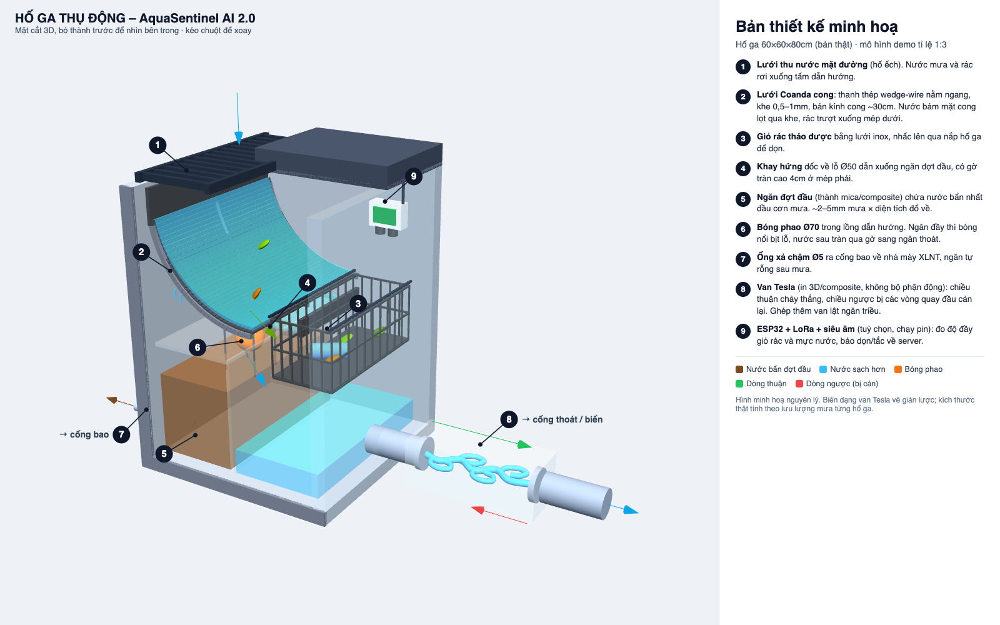

# Hố Ga Thụ Động: xử lý từ hố ga, hố ếch, không cần điện

Ý tưởng: thay vì chỉ chặn ở cửa xả cuối cùng, xử lý rác và nước bẩn đợt đầu **ngay tại hố ga/hố ếch** ven đường, bằng các phát minh cơ khí đã được chứng minh, không có bộ phận chuyển động phải cấp điện. Hộp Cửa Xả Thông Minh ([FIRST_FLUSH.md](FIRST_FLUSH.md)) vẫn giữ làm lớp cuối.

## 3 lớp trong 1 hố ga


Mô hình 3D xoay được: tải [hoga3d.html](hoga3d.html) về rồi mở bằng Chrome.

```
 Nước mưa mặt đường
        │
 [1] Lưới Coanda cong (khe 1mm) ──► rác, lá trượt ra ──► giỏ rác tháo được
        │ nước lọt khe
 [2] Ngăn đợt đầu + bóng phao ──► đầy thì bóng nổi bịt lỗ, nước sau chảy vòng qua
        │ lỗ xả chậm Ø4–6mm            │
        ▼                              ▼
   cống bao (về nhà máy XLNT)     [3] Van Tesla ──► cống thoát nước mưa ──► biển
                                      (cản nước triều chảy ngược)
```

### [1] Lưới Coanda: tách rác tự làm sạch
- Tấm lưới thép không gỉ dạng **wedge-wire** (thanh tam giác), uốn cong, khe 0.5–1mm. Nước bám theo mặt cong (hiệu ứng Coanda) và lọt qua khe. Rác, lá, túi nilon trượt ra mép dưới rơi vào giỏ.
- Đã dùng thật ở cửa lấy nước thủy điện nhỏ và hệ thống thoát nước mưa. Ưu điểm: gần như không tắc, không cần điện.
- Cần chênh cao khoảng 30–50cm từ mép đổ nước tới đáy. Hố ếch quá nông thì đặt ở hố ga lớn hơn phía sau.

### [2] Ngăn đợt đầu có bóng phao
- Là bộ tách nước mưa đầu (first-flush diverter) của hệ thống hứng nước mưa mái nhà, phóng to cho hố ga.
- Nước bẩn đầu tiên chảy vào ngăn chứa. Ngăn đầy thì bóng phao nổi lên bịt miệng, nước sạch hơn phía sau chảy vòng qua ra cống thoát.
- Đáy ngăn có lỗ nhỏ xả chậm vào cống bao, nên sau mưa ngăn tự rỗng, sẵn sàng cho cơn mưa sau.
- Thể tích gợi ý: 2–5mm mưa × diện tích mặt đường đổ về hố ga. Ví dụ 200m² × 3mm = 600 lít.

### [3] Van Tesla: cản nước chảy ngược
- Không có bộ phận chuyển động. Chiều thuận nước chảy thẳng, chiều ngược nước bị các nhánh vòng quay đầu, tự cản lại.
- Dùng để giảm nước triều cường và nước cống dâng ngược lên hố ga.
- **Giới hạn phải nói rõ:** van Tesla chỉ cản, **không bịt kín** (chiều ngược thường chỉ chảy chậm hơn khoảng 2–4 lần, tuỳ thiết kế và lưu lượng). Ngoài thực tế nên ghép với van lật ngăn triều có sẵn, không thay thế nó. Các nhánh hẹp dễ kẹt rác nên phải đặt **sau** lưới Coanda.

## Cảm biến (tuỳ chọn)
Hố ga thụ động vẫn chạy khi mất điện. Gắn thêm 1 ESP32 + LoRa dùng pin:
- Siêu âm đo độ đầy giỏ rác: gửi lệnh dọn khi > 70% (nối với tính năng "Chiến binh xanh" đã có).
- Phao/siêu âm đo mực nước hố ga: phát hiện tắc cống sớm.

## Thí nghiệm cho giám khảo (đo được số)
1. **Van Tesla in 3D:** cho cùng 1 cột nước chảy chiều thuận và chiều ngược, đo số giây chảy hết 1 lít. Tỉ số = độ "một chiều" (diodicity). So với ống thẳng cùng kích thước.
2. **Lưới Coanda:** đổ 1 xô nước có lá, cát, giấy vụn. Cân rác trong giỏ và rác lọt xuống. So với lưới phẳng: sau 10 xô, lưới phẳng tắc còn lưới Coanda vẫn thông.
3. **Ngăn đợt đầu:** đổ nước cà phê trước rồi nước sạch. Đo độ đục nước ra cống thoát khi có và không có ngăn.

## Làm mô hình
| Bộ phận | Cách làm | Giá tham khảo |
|---|---|---|
| Lưới Coanda | Mua tấm wedge-wire nhỏ, hoặc in 3D tấm cong có khe 1mm (PETG) | 100–300k |
| Van Tesla | In 3D 2 nửa, dán keo + gioăng, nối ống Ø21 | ~80k |
| Ngăn đợt đầu | Ống PVC Ø90 + bóng nhựa Ø70 + nắp có lỗ Ø50 làm "miệng" | ~80k |
| Vỏ hố ga | Hộp mica trong, khoan lỗ nối ống | ~200k |

> Đây là thiết kế mô hình để thử nghiệm. Kích thước thật phải tính theo lưu lượng mưa của từng hố ga và phải được đơn vị thoát nước đồng ý mới lắp ngoài đường.
