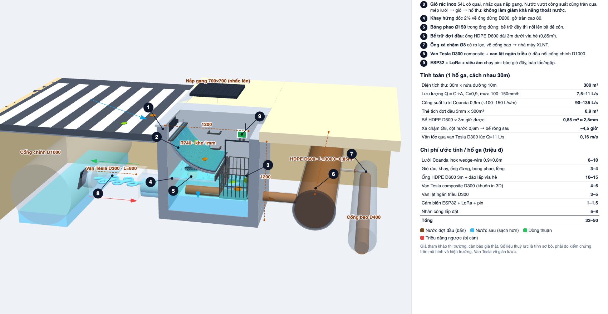

# Hố Ga Thụ Động v2: xử lý rác và nước bẩn đợt đầu ngay tại hố ga

Xử lý **ngay tại hố ga hàm ếch** ven đường, trước khi nước xuống cống chính rồi ra biển. Dùng 3 nguyên lý cơ khí đã được chứng minh, **không cần điện**. Hộp Cửa Xả Thông Minh ([FIRST_FLUSH.md](FIRST_FLUSH.md)) vẫn là lớp cuối ở cửa xả.

Mô hình 3D xoay được: tải [hoga3d_v2.html](hoga3d_v2.html) rồi mở bằng Chrome. Bản nguyên lý đơn giản: [hoga3d.png](hoga3d.png).

## 1. Thiết kế (kích thước thật, mm)
| # | Bộ phận | Thông số |
|---|---|---|
| 1 | Cửa thu hàm ếch ở bó vỉa | Khe cao 220, song chắn thép chống rác lớn |
| 2 | Lưới Coanda | Inox wedge-wire, bán kính cong 740, rộng 900, khe 1mm |
| 3 | Giỏ rác | Inox 400×380×760 (~115L), có quai, nhấc qua nắp gang 700×700 |
| 4 | Khay hứng | Dốc 2% về ống đứng D200, gờ tràn cao 80 |
| 5 | Ống đứng + bóng phao | D200, bóng nhựa rỗng Ø150, đế côn cao su để bịt kín |
| 6 | Bể trữ đợt đầu | Ống HDPE D600 dài 3m, chôn dưới vỉa hè |
| 7 | Ống xả chậm | Ø8 có rọ lọc, nối cống bao (cống thu gom nước thải) |
| 8 | Van Tesla + van lật ngăn triều | D300 composite, dài 800, ở đầu nối cống chính D1000 |
| 9 | Cảm biến (tuỳ chọn) | ESP32 + LoRa + siêu âm, pin 18650 |
| — | Thân hố ga | BTCT lòng 1200×1000, sâu 1200, thành 150 |

**Đường tràn an toàn:** khi mưa vượt công suất, nước cùng rác tràn qua mép dưới lưới → giỏ → hố thu → ống ra. Hố ga không bao giờ thoát nước kém hơn hố ga thường.

## 2. Tính toán sơ bộ (1 hố ga, khoảng cách 30m)
| Hạng mục | Công thức | Kết quả |
|---|---|---|
| Diện tích thu | 30m × nửa mặt đường 10m | 300 m² |
| Lưu lượng đỉnh | Q = C·i·A/3600, C=0,9, i = 100–150 mm/h | 7,5–11 L/s |
| Công suất lưới Coanda | ~100–150 L/s cho mỗi mét bề rộng (số liệu nhà sản xuất), rộng 0,9m | 90–135 L/s, dư ~10 lần |
| Thể tích đợt đầu cần giữ | 3mm mưa × 300m² | 0,9 m³ |
| Bể HDPE D600 dài 3m | π·0,3²·3 | 0,85 m³ ≈ 2,8mm mưa |
| Thời gian bể tự rỗng | lỗ Ø8, Cd=0,6, cột nước 0,6m | ~4,5 giờ (Ø5 thì ~12 giờ và dễ tắc) |
| Vận tốc qua van Tesla | 11 L/s qua D300 | 0,16 m/s, tổn thất cột nước không đáng kể |

- Vì sao chọn 3mm: các nghiên cứu "first-flush" cho thấy phần nước đầu cơn mưa chứa tỉ lệ chất bẩn cao hơn hẳn phần sau. Con số chính xác khác nhau theo từng tuyến đường, **phải đo**: lấy mẫu mỗi 5 phút trong 3–5 cơn mưa, đo độ đục/TSS để vẽ đường cong.
- Hố ga thường chỉ chứa được ~0,1 m³ (≈0,3mm mưa), quá ít. Vì vậy bản v2 thêm **ống trữ HDPE dưới vỉa hè**.

## 3. Chi phí ước tính (1 hố ga, triệu đồng)
| Hạng mục | Chi phí |
|---|---|
| Lưới Coanda inox wedge-wire 0,9×0,8m | 6–10 |
| Giỏ rác, khay, ống đứng, bóng phao, lồng | 3–4 |
| Ống HDPE D600 3m + đào lấp, hoàn trả vỉa hè | 10–15 |
| Van Tesla composite D300 (khuôn in 3D) | 4–6 |
| Van lật ngăn triều D300 | 3–5 |
| Cảm biến ESP32 + LoRa + pin | 1–1,5 |
| Nhân công lắp đặt | 5–8 |
| **Tổng** | **32–50** |

- Bản rút gọn chỉ có lưới Coanda + giỏ rác (lắp vào hố ga có sẵn, không đào): ~12–18 triệu.
- Mô hình demo tỉ lệ 1:5 (mica, in 3D, ống PVC): ~1,5–2 triệu.
- Giá tham khảo, cần lấy báo giá thật (đặc biệt tấm wedge-wire).

## 4. Tính khả thi
**Thuận lợi**
- Không cần điện, không có mô-tơ: chạy được khi bão mất điện.
- Lắp từng hố ga, làm dần được. Không phải xây bể chứa lớn hàng chục tỉ.
- Dùng vật tư có bán sẵn: tấm wedge-wire, ống HDPE, bóng phao, van lật.

**Khó khăn và cách xử lý**
| Khó khăn | Cách xử lý |
|---|---|
| Lưới Coanda cần chênh cao ~30–50cm | Chọn hố ga sâu ≥ 1m; hố nông chỉ lắp giỏ rác |
| Phải dọn giỏ rác | Cảm biến báo khi giỏ > 70%; giỏ có quai nhấc qua nắp |
| Lỗ xả chậm dễ tắc | Dùng Ø8 + rọ lọc, kiểm tra theo mùa |
| Van Tesla chỉ cản, không bịt kín (chiều ngược chậm hơn ~2–4 lần) | Luôn ghép van lật ngăn triều |
| Đào vỉa hè cần giấy phép | Làm thí điểm 3–5 hố ga gần cửa xả, chợ, khu nhà hàng cùng đơn vị thoát nước |

**Không lắp ở mọi hố ga.** Ưu tiên nơi bẩn nhất (chợ, nhà hàng, bãi xe) và gần cửa xả ra biển.

## 5. Điểm sáng tạo
1. **Ghép 3 phát minh cũ thành 1 hệ thụ động:** lưới Coanda (thuỷ điện nhỏ), bộ tách nước mưa đầu bằng bóng phao (hứng nước mưa mái nhà), van Tesla (1920). Chưa thấy ghép chung trong hố ga đô thị.
2. **Xử lý phân tán tại nguồn** thay vì chỉ chặn ở cửa xả.
3. **Luôn an toàn chống ngập:** mọi đường đều có lối tràn, không bao giờ làm hố ga thoát nước kém đi.
4. **Đo được, chứng minh được:** cảm biến + LoRa gửi dữ liệu về AquaSentinel; mỗi bộ phận có thí nghiệm định lượng.

## 6. Thí nghiệm trên mô hình
1. **Van Tesla in 3D:** cùng cột nước, đo thời gian chảy 1 lít theo chiều thuận và chiều ngược. Tỉ số = độ một chiều. So với ống thẳng.
2. **Lưới Coanda và lưới phẳng:** 10 xô nước có lá, cát, giấy vụn. Cân rác trong giỏ, xem lưới nào tắc.
3. **Bể trữ đợt đầu:** đổ nước cà phê rồi nước sạch. Đo độ đục nước ra cống chính khi có và không có bể.

## 7. Lộ trình
1. Mô hình 1:5 và 3 thí nghiệm (2–3 tuần).
2. Lấy mẫu nước 3–5 cơn mưa tại 1 hố ga thật để có đường cong first-flush.
3. Đề xuất thí điểm 1 hố ga với đơn vị thoát nước.

> Đây là thiết kế đề xuất để nghiên cứu. Kích thước thật phải tính theo từng hố ga và phải được đơn vị quản lý thoát nước đồng ý trước khi lắp ngoài đường.
