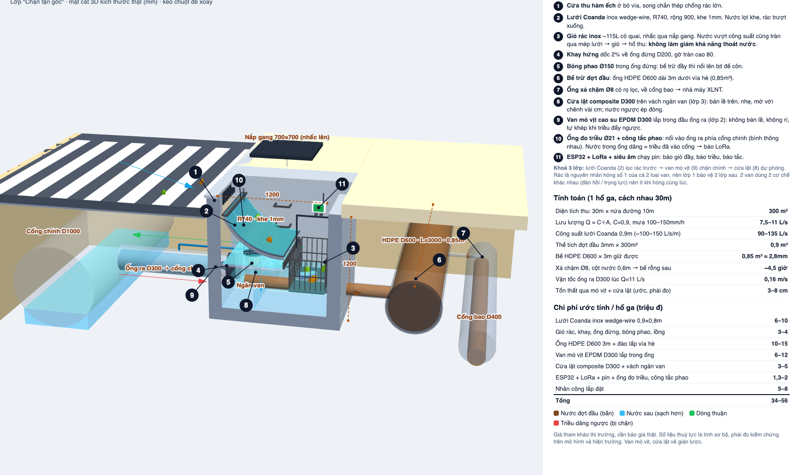
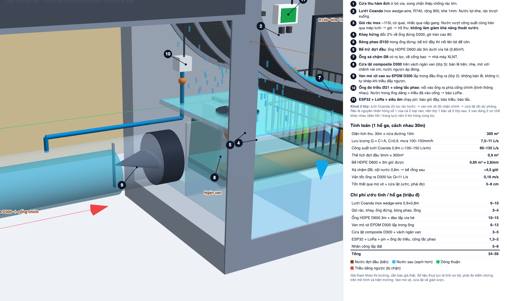

# Hố Ga Thụ Động v3: chặn rác, nước bẩn đợt đầu và triều ngược ngay tại hố ga

Xử lý **ngay tại hố ga hàm ếch** ven đường, trước khi nước xuống cống chính rồi ra biển. Dùng 3 nguyên lý cơ khí đã được chứng minh, **không cần điện**. Hộp Cửa Xả Thông Minh ([FIRST_FLUSH.md](FIRST_FLUSH.md)) vẫn là lớp cuối ở cửa xả.

Mô hình 3D xoay được: tải [hoga3d_v3.html](hoga3d_v3.html) rồi mở bằng Chrome (thêm `?detail` để xem cận cảnh van). Video mô phỏng: [hoga_mophong.html](hoga_mophong.html). Bản cũ dùng van Tesla: [hoga3d_v2.png](hoga3d_v2.png).

**v3 thay gì so với v2:** bỏ van Tesla làm van chính (Tesla chỉ cản bớt, vẫn rò ngược và dễ tắc rác). Thay bằng **khoá chống triều 3 lớp**, xem mục 1b.

## 1. Thiết kế (kích thước thật, mm)
| # | Bộ phận | Thông số |
|---|---|---|
| 1 | Cửa thu hàm ếch ở bó vỉa | Khe cao 220, song chắn thép chống rác lớn |
| 2 | Lưới Coanda | Inox wedge-wire, bán kính cong 740, rộng 900, khe 1mm |
| 3 | Giỏ rác | Inox 400×380×760 (~115L), có quai, nhấc qua nắp gang 700×700 |
| 4 | Khay hứng | Dốc 2% về ống đứng D200, gờ tràn cao 80 |
| 5 | Ống đứng + bóng phao | D200, bóng nhựa rỗng Ø150, đế côn cao su để bịt kín |
| 6 | Bể trữ đợt đầu | Ống HDPE D600 dài 3m, chôn dưới vỉa hè |
| 7 | Ống xả chậm | Ø8 có rọ lọc, nối cống bao (cống thu gom nước thải) |
| 8 | Cửa lật composite (lớp 3) | D300, bản lề trên, gắn trên vách ngăn van trong hố ga |
| 9 | Van mỏ vịt cao su EPDM (lớp 2) | D300, lắp trong đầu ống ra, mỏ hướng về cống chính D1000 |
| 10 | Ống đo triều + công tắc phao | Ống PVC Ø21 nối vào ống ra phía sau van mỏ vịt, dẫn về ngăn van |
| 11 | Cảm biến (tuỳ chọn) | ESP32 + LoRa + siêu âm + công tắc phao, pin |
| — | Thân hố ga | BTCT lòng 1200×1000, sâu 1200, thành 150 |

**Ngăn van:** vách ngăn thấp (cao 440) tách góc hố thu thành ngăn riêng 350×380, có ống ngắn D300 xuyên vách. Nhấc nắp gang là với tới cả 2 van để kiểm tra, thay.

**Đường tràn an toàn:** khi mưa vượt công suất, nước cùng rác tràn qua mép dưới lưới → giỏ → hố thu → ống ra. Hố ga không bao giờ thoát nước kém hơn hố ga thường.

## 1b. Khoá chống triều 3 lớp

| | Van Tesla | Cửa lật | Van mỏ vịt cao su |
|---|---|---|---|
| Đóng kín | Không, chỉ cản bớt, vẫn rò | Kín nếu không kẹt rác | Kín nếu không kẹt rác |
| Bộ phận chuyển động | Không | Bản lề (rỉ trong nước mặn) | Không (môi cao su đàn hồi) |
| Chênh mực để mở | Không cần | Cửa gang nặng cần chênh lớn; composite nhẹ thì vài cm | Vài cm |
| Hỏng thường gặp | Tắc kênh hẹp | Rác kẹt khe, bản lề kẹt, đập mạnh, bị trộm | Rác kẹt giữa 2 môi, cao su lão hoá |

**Nhận xét:** cửa lật và mỏ vịt đều hỏng chủ yếu vì **rác kẹt**. Hố ga này đã có lưới Coanda lọc rác > 1 mm phía trước, nên ghép lại thành 3 lớp nối tiếp:

1. **Lớp 1 – Lưới Coanda:** lọc rác trước khi nước tới van. Vừa chặn rác ra biển, vừa bảo vệ 2 lớp van phía sau.
2. **Lớp 2 – Van mỏ vịt EPDM trong ống ra (van chính):** lắp trong hố ga, không ra sát biển → không phơi nắng, ít hà bám, không bị phá, thay được qua nắp gang.
3. **Lớp 3 – Cửa lật composite trên vách ngăn van (dự phòng):** nếu mỏ vịt bị kẹt hở, nước ngược tràn vào ngăn van sẽ ép cửa lật đóng vào vách. Cửa composite nhẹ, nằm trong hố ga nên không gặp nước mặn thường xuyên, không bị trộm.

2 van dùng **2 cơ chế khác nhau** (môi cao su đàn hồi / cửa đóng bằng trọng lực), nên ít khi hỏng cùng lúc.

**Vì sao không dùng phao nổi bịt ống:** phao nổi sẽ tự bịt cả khi mưa to làm nước dâng xuôi chiều trong hố ga → hố ga không thoát được, gây ngập. Cửa lật chỉ đóng khi nước đẩy **ngược chiều**, nên an toàn hơn.

**Ống đo triều (bình thông nhau):** ống Ø21 nối vào ống ra phía cống chính. Khi triều dâng vào cống, nước trong ống Ø21 dâng theo và nâng công tắc phao → ESP32 gửi LoRa "cống chính đang dâng ngược" → hộp báo động trên trụ điện gần đó chuyển **vàng sớm**, trước khi nước tràn lên mặt đường. Nối lớp "Chặn tận gốc" với lớp "Cảnh báo kịp thời".

**Van Tesla:** không dùng trong bản chính. Có thể giữ làm thí nghiệm so sánh trên mô hình (mục 6).

## 2. Tính toán sơ bộ (1 hố ga, khoảng cách 30m)
| Hạng mục | Công thức | Kết quả |
|---|---|---|
| Diện tích thu | 30m × nửa mặt đường 10m | 300 m² |
| Lưu lượng đỉnh | Q = C·i·A/3600, C=0,9, i = 100–150 mm/h | 7,5–11 L/s |
| Công suất lưới Coanda | ~100–150 L/s cho mỗi mét bề rộng (số liệu nhà sản xuất), rộng 0,9m | 90–135 L/s, dư ~10 lần |
| Thể tích đợt đầu cần giữ | 3mm mưa × 300m² | 0,9 m³ |
| Bể HDPE D600 dài 3m | π·0,3²·3 | 0,85 m³ ≈ 2,8mm mưa |
| Thời gian bể tự rỗng | lỗ Ø8, Cd=0,6, cột nước 0,6m | ~4,5 giờ (Ø5 thì ~12 giờ và dễ tắc) |
| Vận tốc ống ra | 11 L/s qua D300 | 0,16 m/s |
| Tổn thất qua mỏ vịt + cửa lật | ước tính, **phải đo** | ~3–8 cm cột nước, hố sâu 1,2 m còn dư |

- Vì sao chọn 3mm: các nghiên cứu "first-flush" cho thấy phần nước đầu cơn mưa chứa tỉ lệ chất bẩn cao hơn hẳn phần sau. Con số chính xác khác nhau theo từng tuyến đường, **phải đo**: lấy mẫu mỗi 5 phút trong 3–5 cơn mưa, đo độ đục/TSS để vẽ đường cong.
- Hố ga thường chỉ chứa được ~0,1 m³ (≈0,3mm mưa), quá ít. Vì vậy bản v2 thêm **ống trữ HDPE dưới vỉa hè**.

## 3. Chi phí ước tính (1 hố ga, triệu đồng)
| Hạng mục | Chi phí |
|---|---|
| Lưới Coanda inox wedge-wire 0,9×0,8m | 6–10 |
| Giỏ rác, khay, ống đứng, bóng phao, lồng | 3–4 |
| Ống HDPE D600 3m + đào lấp, hoàn trả vỉa hè | 10–15 |
| Van mỏ vịt cao su EPDM D300 lắp trong ống | 6–12 |
| Cửa lật composite D300 + vách ngăn van | 3–5 |
| ESP32 + LoRa + pin + ống đo triều, công tắc phao | 1,3–2 |
| Nhân công lắp đặt | 5–8 |
| **Tổng** | **34–56** |

- Bản rút gọn chỉ có lưới Coanda + giỏ rác (lắp vào hố ga có sẵn, không đào): ~12–18 triệu.
- Mô hình demo tỉ lệ 1:5 (mica, in 3D, ống PVC): ~1,5–2 triệu.
- Giá tham khảo, cần lấy báo giá thật (đặc biệt tấm wedge-wire).

## 4. Tính khả thi
**Thuận lợi**
- Không cần điện, không có mô-tơ: chạy được khi bão mất điện.
- Lắp từng hố ga, làm dần được. Không phải xây bể chứa lớn hàng chục tỉ.
- Dùng vật tư có bán sẵn: tấm wedge-wire, ống HDPE, bóng phao, van mỏ vịt cao su, cửa lật composite.

**Khó khăn và cách xử lý**
| Khó khăn | Cách xử lý |
|---|---|
| Lưới Coanda cần chênh cao ~30–50cm | Chọn hố ga sâu ≥ 1m; hố nông chỉ lắp giỏ rác |
| Phải dọn giỏ rác | Cảm biến báo khi giỏ > 70%; giỏ có quai nhấc qua nắp |
| Lỗ xả chậm dễ tắc | Dùng Ø8 + rọ lọc, kiểm tra theo mùa |
| Van mỏ vịt bị rác kẹt hở | Lưới Coanda lọc trước; cửa lật dự phòng phía sau |
| Cao su lão hoá | Đặt trong ống, tránh nắng; kiểm tra mỗi mùa mưa, thay sau vài năm |
| Đào vỉa hè cần giấy phép | Làm thí điểm 3–5 hố ga gần cửa xả, chợ, khu nhà hàng cùng đơn vị thoát nước |

**Không lắp ở mọi hố ga.** Ưu tiên nơi bẩn nhất (chợ, nhà hàng, bãi xe) và gần cửa xả ra biển.

## 5. Điểm sáng tạo
1. **Ghép các phát minh cũ thành 1 hệ thụ động:** lưới Coanda (thuỷ điện nhỏ), bộ tách nước mưa đầu bằng bóng phao (hứng nước mưa mái nhà), van mỏ vịt + cửa lật (chống triều). Điểm mới là **cách ghép**: lưới lọc rác đặt trước để bảo vệ van, 2 van khác cơ chế nối tiếp, ống đo triều báo sớm cho hộp cảnh báo.
2. **Xử lý phân tán tại nguồn** thay vì chỉ chặn ở cửa xả.
3. **Luôn an toàn chống ngập:** mọi đường đều có lối tràn, không bao giờ làm hố ga thoát nước kém đi.
4. **Đo được, chứng minh được:** cảm biến + LoRa gửi dữ liệu về AquaSentinel; mỗi bộ phận có thí nghiệm định lượng.

## 6. Thí nghiệm trên mô hình
1. **Giàn thử chống triều** (ống mica trong suốt): so 5 cấu hình: chỉ van Tesla in 3D / chỉ cửa lật / chỉ mỏ vịt / mỏ vịt + cửa lật / mỏ vịt + cửa lật + lưới. Cho nước ngược cao 10–20–40 cm, đo lượng rò (lít/phút) bằng cốc chia vạch. Lặp lại khi thả lá, nilon, que vào dòng chảy thuận trước đó. Ra biểu đồ so sánh.
2. **Lưới Coanda và lưới phẳng:** 10 xô nước có lá, cát, giấy vụn. Cân rác trong giỏ, xem lưới nào tắc.
3. **Bể trữ đợt đầu:** đổ nước cà phê rồi nước sạch. Đo độ đục nước ra cống chính khi có và không có bể.

## 7. Lộ trình
1. Mô hình 1:5 và 3 thí nghiệm (2–3 tuần).
2. Lấy mẫu nước 3–5 cơn mưa tại 1 hố ga thật để có đường cong first-flush.
3. Đề xuất thí điểm 1 hố ga với đơn vị thoát nước.

> Đây là thiết kế đề xuất để nghiên cứu. Kích thước thật phải tính theo từng hố ga và phải được đơn vị quản lý thoát nước đồng ý trước khi lắp ngoài đường.
