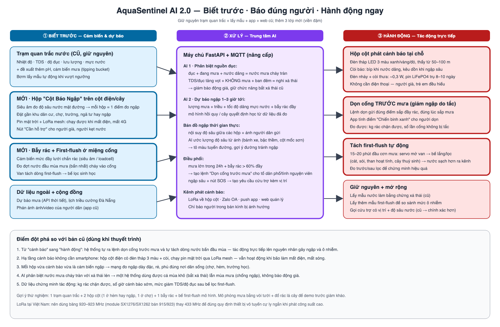

# AquaSentinel AI 2.0 — Đề xuất nâng cấp

**Từ "phát hiện xả thải lén" sang "chống ngập + chống ô nhiễm nước", và từ "cảnh báo" sang "hành động".**



## 1. Nhận xét bản hiện tại

**Điểm mạnh nên giữ:** trạm đo 5 thông số qua LoRa, bơm lấy mẫu làm bằng chứng (điểm khác biệt tốt), app Flutter có bản đồ + phản ánh hiện trường, web quản lý FastAPI, buồng đo inox + tấm đồng chống bám bẩn (sáng tạo, rẻ).

**Điểm yếu giám khảo dễ hỏi:**
1. Chỉ dừng ở *cảnh báo* và *lấy mẫu*. Chưa có gì tác động trực tiếp lên môi trường.
2. Mùa mưa nước đục và dâng do mưa sẽ kích hoạt báo động giả "xả thải" liên tục.
3. Cảnh báo chỉ đến người có smartphone/app. Người già, trẻ em, người đi đường không nhận được.
4. Cảm biến mực nước đã có (JSN-SR04T) nhưng chưa khai thác cho bài toán ngập.
5. Thiếu pH và lượng mưa. YF-S201 dễ tắc rác khi đặt ngoài kênh.

## 2. Ba lớp nâng cấp

### ① Biết trước
- **Hộp "Cột Báo Ngập"** gắn cột điện/cây gần khu dân cư, chợ, trường, hẻm hay ngập. Siêu âm chĩa xuống mặt đường nên mỗi hộp là **một điểm đo ngập**. Chạy pin mặt trời + LoRa, vẫn hoạt động khi bão làm mất điện và mất sóng 4G.
- **Bẫy rác thông minh** ở miệng cống/cửa xả: đo mức đầy lưới chắn rác.
- **Dữ liệu ngoài:** dự báo mưa (API thời tiết), lịch triều cường Đà Nẵng, ảnh người dân gửi.

### ② Xử lý bằng AI (server)
- **AI 1 – Phân biệt nguồn gây đục** ([classify.py](classify.py)). Mưa + nước dâng + đục tăng mà TDS loãng ra là nước chảy tràn. Không mưa + TDS tăng vọt ban đêm là nghi xả thải. Nhờ đó **một hệ thống dùng được cả 2 mùa** mà không báo động giả.
- **AI 2 – Dự báo ngập 1–3 giờ tới:** dựa trên mưa sắp tới, triều, độ sâu hiện tại, tốc độ dâng và độ đầy bẫy rác.
- **Bản đồ ngập thời gian thực:** nội suy độ sâu giữa các hộp, kết hợp ảnh người dân (AI ước lượng độ sâu từ bánh xe, bậc thềm). Tô màu tuyến đường và gợi ý đường tránh.

### ③ Hành động trực tiếp (phần "đột phá")
| Tác động | Cách làm | Đo hiệu quả bằng |
|---|---|---|
| Cảnh báo tại chỗ, không cần điện thoại | Hộp cột: đèn tháp LED 3 màu có còi. Xanh chớp = an toàn, vàng nháy + bíp = nước đang dâng, đỏ nháy + còi = không đi qua ([flood_beacon.ino](flood_beacon.ino)) | Số phút cảnh báo sớm trước khi ngập |
| **Dọn cống TRƯỚC mưa** | Sắp mưa lớn trong 24h và bẫy rác > 60% thì tự tạo lệnh dọn cho tổ dân phố/tình nguyện viên. App tính điểm "Chiến binh xanh" | kg rác chặn được, số lần cống không tắc |
| **Giữ nước mưa đợt đầu tại cửa xả** | Gắn hộp tại giếng tách dòng của cửa xả ven biển: mưa bắt đầu thì đóng cửa phai ra biển, bơm đợt đầu vào cống bao; nước trong lại thì mở; nước dâng cao thì mở ngay chống ngập ([FIRST_FLUSH.md](FIRST_FLUSH.md)) | Độ đục/TDS nước ra biển khi có và không có hệ thống |
| Cứu trợ chính xác | Nút SOS trên hộp cột gửi vị trí + độ sâu nước thật | Thời gian phản hồi yêu cầu |
| Giữ chức năng cũ | Lấy mẫu bằng chứng xả thải, và lấy thêm mẫu first-flush để so sánh | — |

## 3. Câu chuyện khi thuyết trình
> "Bản 1.0 giúp *phát hiện* ô nhiễm. Bản 2.0 giúp *ngăn* ô nhiễm và ngập: biết trước khi mưa, báo cho cả người không có điện thoại, và tự hành động dọn rác, lọc nước bẩn đầu mùa trước khi nó ra sông."

## 4. Mô hình demo trước giám khảo
- 1 trạm quan trắc (cũ) + 2 hộp cột (1 ở hẻm hay ngập, 1 ở chợ) + 1 bẫy rác + mô hình cửa xả + giếng tách dòng bằng hộp mica.
- Mô phỏng mưa bằng bình tưới. Đổ lá cây/rác vào lưới để kích hoạt lệnh dọn. Dâng nước trong khay để đèn hộp cột chuyển vàng rồi đỏ, còi kêu.

## 5. Linh kiện thêm (ước tính)
| Hạng mục | Linh kiện | Giá tham khảo |
|---|---|---|
| Hộp cột (mỗi hộp) | Xem danh sách đầy đủ ở mục 6 | ~1,9–2,7 tr (bản demo bàn ~1,1–1,4 tr) |
| Bẫy rác | Lưới inox, siêu âm hoặc loadcell 20kg + HX711 | ~200k |
| Cửa xả thông minh | ESP32 + LoRa, tipping bucket, độ đục SEN0189, JSN-SR04T, servo + mica, bơm mini | ~950k |
| Trạm cũ bổ sung | Cảm biến pH analog, cảm biến mưa tipping bucket | ~400k |

## 6. Hộp cột: đèn tháp 3 màu có còi

### Vì sao bỏ tấm LED chạy chữ
| | Tấm WS2812B 8x32 | Đèn tháp LED 3 màu + còi |
|---|---|---|
| Ngoài trời | Phải nằm sau mặt kính, nắng gắt khó đọc, LED dễ chết lẻ | Vỏ IP65, thiết kế cho nhà xưởng/ngoài trời |
| Nhìn từ xa | Chữ nhỏ, phải lại gần mới đọc | Thấy màu từ 50–100 m, cả khi mưa |
| Người không đọc được chữ / trẻ em / ban đêm | Khó hiểu | Xanh–vàng–đỏ ai cũng hiểu, còi báo cả người không nhìn |
| Điện | 1,5–3 W liên tục | ~0,3–0,4 W trung bình (đèn nháy, còi thưa) |
| Dây | 5V lớn + tín hiệu nhạy nhiễu | 12V, 5 dây, bật/tắt đơn giản |

### Cách báo
| Mức | Đèn | Còi |
|---|---|---|
| An toàn | Xanh chớp 0,1 s mỗi 5 s ("hộp đang sống") | Tắt |
| Chú ý (≥ 10 cm hoặc trung tâm dự báo) | Vàng nháy 1 Hz | Bíp dồn 10 s khi vừa lên mức, sau đó 1 bíp / 2 phút |
| Nguy hiểm (≥ 30 cm) | Đỏ nháy 2 Hz | Kêu dồn 10 s, sau đó 3 bíp / 30 s |
| Vừa bấm SOS | 3 màu chạy vòng 30 s | Bíp ngắn mỗi 2 s |
| Bật nguồn | Đỏ → vàng → xanh + 1 bíp (tự kiểm) | |

### Đấu nối
```
Tấm pin 10W 18V ─[TVS SMBJ24A]─ Bộ sạc solar 12V (chế độ LiFePO4) ─ Pin LiFePO4 12,8V 6Ah
                                          │ (cổng LOAD)
                                    [Cầu chì 2A] ── BUS 12V ──┬── dây CHUNG đèn tháp (+12V)
                                                              ├── ULN2003 chân 9 (COM, chống xung ngược của còi)
                                                              └── Buck 12V→5V ── ESP32 VIN, JSN-SR04T 5V
                                                                    (tụ 470µF 25V ở đầu vào buck)
ESP32 GPIO27 → ULN2003 IN1 → OUT1 → dây ĐỎ
ESP32 GPIO4  → ULN2003 IN2 → OUT2 → dây VÀNG
ESP32 GPIO13 → ULN2003 IN3 → OUT3 → dây XANH
ESP32 GPIO16 → ULN2003 IN4 → OUT4 → dây CÒI
ULN2003 chân 8 (GND) ── GND chung ESP32 ── âm pin
JSN-SR04T: TRIG → GPIO32; ECHO → 1kΩ → GPIO33, GPIO33 → 2kΩ → GND (hạ 5V xuống 3,3V)
Nút SOS: GPIO25 ↔ GND (dùng điện trở kéo lên trong ESP32)
LoRa SX1276: NSS 5, RST 14, DIO0 26, SCK 18, MISO 19, MOSI 23, 3,3V
```
- **Mua đèn loại 12VDC, CHUNG DƯƠNG** (dây đen/chung nối +12V, từng màu nối xuống GND thì sáng). Đa số đèn tháp mini LTA-205 bản DC là loại này, nhưng hỏi shop hoặc thử bằng nguồn 12V trước khi đấu. Mua nhầm loại chung âm thì thay ULN2003 bằng module 4 relay.
- ULN2003 chịu 500 mA/kênh, thừa cho đèn LED (~20–50 mA/màu) và còi (~20–40 mA).
- Ước tính điện: ESP32 + LoRa nghe ~0,25–0,3 W, đèn + còi trung bình < 0,1 W → ~7–9 Wh/ngày. Pin 6Ah (~77 Wh) giữ được **~8–10 ngày mưa không có nắng**; tấm 10 W sạc bù đủ trong 1 ngày nắng.

### Tăng độ bền
- Pin **LiFePO4** thay 18650: chịu nóng trong hộp phơi nắng tốt hơn, không phồng/cháy, ~2000 chu kỳ.
- Hộp IP65 + **nút thông hơi chống nước** (chống đọng hơi nước làm rỉ mạch) + gói hút ẩm.
- Dây ra vào qua **ốc siết cáp**, khoan lỗ dưới đáy hộp, không khoan mặt trên.
- **Sơn phủ mạch** (conformal coating) sau khi test xong.
- **TVS** ở đầu tấm pin chống xung sét lan truyền; cầu chì 2A đầu nhánh tải.
- Đèn tháp gắn **dưới mái che** nhỏ, cảm biến siêu âm có ống che mưa, treo bằng đai inox.

### Danh sách linh kiện cần mua (1 hộp)
| # | Linh kiện | SL | Giá tham khảo |
|---|---|---|---|
| 1 | ESP32 DevKit V1 (ESP32-WROOM-32) | 1 | 90–130k |
| 2 | LoRa SX1276 băng 915/923 MHz (vd. RA-01H) + anten 923 MHz SMA + dây pigtail | 1 | 180–260k |
| 3 | Cảm biến siêu âm chống nước JSN-SR04T | 1 | 90–140k |
| 4 | Đèn tháp LED 3 màu có còi 12VDC, chung dương, IP65 (vd. dòng LTA-205-3 có còi) | 1 | 150–350k |
| 5 | IC ULN2003A + đế 16 chân (hoặc module ULN2003) | 1 | 10–25k |
| 6 | Mạch hạ áp 12V → 5V (MP1584 / LM2596) | 1 | 20–40k |
| 7 | Pin LiFePO4 12,8V 6Ah | 1 | 450–700k |
| 8 | Tấm pin mặt trời 10W 18V | 1 | 200–300k |
| 9 | Bộ sạc solar 12V 10A có chế độ Lithium/LiFePO4 | 1 | 120–220k |
| 10 | Nút nhấn chống nước IP67 Ø16 | 1 | 30–60k |
| 11 | Hộp nhựa chống nước IP65 ~200×150×100 | 1 | 120–200k |
| 12 | Ốc siết cáp PG7 ×4, PG9 ×2 | 6 | 25–40k |
| 13 | Nút thông hơi chống nước M12 | 1 | 20–40k |
| 14 | Cầu chì + đế 2A, TVS SMBJ24A, tụ 470µF 25V ×2, tụ 100nF ×4 | — | 30–50k |
| 15 | Điện trở 1kΩ, 2kΩ (chia áp ECHO) | 2 | ~2k |
| 16 | PCB đục lỗ, header, dây 0,5 mm², đầu cos, co nhiệt | — | 50–80k |
| 17 | Đai inox ôm cột + pát gắn + mái che đèn | — | 100–150k |
| 18 | Gói hút ẩm silica, sơn phủ mạch | — | 50–80k |
| | **Tổng** | | **~1,9–2,7 tr** |

**Bản demo trên bàn:** bỏ mục 7, 8, 9, 13, 17, 18, thay bằng adapter 12V 1A (~60k) → **~1,1–1,4 tr**.
Chưa gồm gateway LoRa ở trung tâm (dùng chung cho nhiều hộp).

## 7. Lưu ý kỹ thuật
- **Tần số LoRa:** Việt Nam dùng băng 920–923 MHz (AS923) cho LoRa. Nên đổi RA-02 433 MHz sang module 915/923 MHz.
- **Đo lưu lượng:** YF-S201 dễ tắc rác ngoài kênh. Có thể ước lượng lưu lượng từ mực nước + tiết diện kênh, hoặc dùng phao đo vận tốc.
- **Bảo mật tài liệu:** bản PDF hiện có ghi tên và mật khẩu Wi-Fi thật. Nên xóa trước khi nộp hoặc chia sẻ công khai.

## Files
- `flood_beacon.ino`: firmware hộp Cột Báo Ngập (ESP32 + LoRa + siêu âm + đèn tháp 3 màu có còi + SOS)
- [HO_GA_THU_DONG.md](HO_GA_THU_DONG.md): hố ga thụ động (lưới Coanda + ngăn đợt đầu bóng phao + van Tesla), không cần điện
- `first_flush.ino`: firmware Cửa Xả Thông Minh, hướng dẫn ở [FIRST_FLUSH.md](FIRST_FLUSH.md)
- `classify.py`: luật AI phân biệt chảy tràn / xả thải và điểm nguy cơ ngập (có self-test: `python3 classify.py`)

> Code mẫu để nhóm phát triển tiếp, chưa test trên phần cứng thật.
