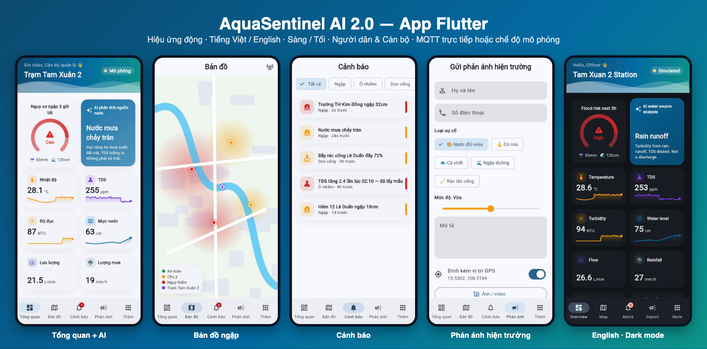

# AquaSentinel AI 2.0 — App Flutter



**Tải APK:** [Releases](https://github.com/CaoLP/Sample-Projects/releases/tag/aquasentinel-app-v2.0.0). Đa số điện thoại dùng bản `arm64-v8a`.

## Có gì
| Màn hình | Nội dung |
|---|---|
| Mở đầu | Logo + sóng nước động, chọn **Người dân** hoặc **Cán bộ** (đăng nhập demo `admin / 123456`), đổi VI/EN |
| Tổng quan | Đồng hồ nguy cơ ngập 3h, thẻ **AI phân tích nguồn nước** (chảy tràn / nghi xả thải), 7 thông số có biểu đồ, van first-flush, 4 Cột Báo Ngập, bẫy rác + nút *Tạo lệnh dọn cống* (cán bộ) |
| Bản đồ | Sông, đường, vùng ngập loang màu theo độ sâu, điểm nhấp nháy. Bấm trạm xem lịch sử min/TB/max; bấm hộp cột xem độ sâu + nút **SOS**. Cán bộ có nút phát cảnh báo LoRa |
| Cảnh báo | Lọc Ngập / Ô nhiễm / Dọn cống / SOS, tự sinh từ AI |
| Phản ánh | Họ tên, SĐT (kiểm tra định dạng), loại sự cố, mức độ, mô tả, GPS, ảnh → mã theo dõi |
| Thêm | Chat hỏi AI theo số liệu trạm, góc học tập, ngôn ngữ, giao diện tối, kết nối MQTT, đăng xuất |

## Dữ liệu
- Mặc định chạy **mô phỏng** kịch bản 2 phút: trời khô → mưa lớn (van first-flush mở, hộp cột chuyển vàng/đỏ, AI báo *chảy tràn*) → nước rút → nửa đêm TDS tăng vọt (AI báo *nghi xả thải*). Rất tiện để demo trước giám khảo.
- Bấm **Thêm → Máy chủ MQTT → Kết nối** để nhận dữ liệu thật từ topic `enviguard/sensor` (JSON giống app cũ: `temperature, tds, turbidity, flow, depth`, thêm `rain, ph` nếu có).
- Luật AI trong `lib/state.dart` giống hệt `../classify.py` (có test: `flutter test`).

## Cấu trúc
```
lib/main.dart      app, theme, splash, đăng nhập, thanh điều hướng
lib/screens.dart   5 màn hình + chat AI
lib/widgets.dart   sóng nước, đồng hồ, biểu đồ, điểm nhấp nháy, bản đồ
lib/state.dart     dữ liệu, mô phỏng, MQTT, AI classify / flood_risk
lib/i18n.dart      bảng tiếng Việt / English
```

## Chạy
```bash
flutter pub get
flutter run                 # điện thoại / giả lập
flutter build apk --release --split-per-abi
```

## Phần cần nối vào hệ thống thật của nhóm
- Đăng nhập: thay tài khoản demo bằng API đăng nhập của server FastAPI.
- Gửi phản ánh: hiện đang giả lập, cần gửi multipart tới `POST /api/reports` và chọn ảnh bằng `image_picker` như app cũ.
- Chat AI: đang trả lời theo từ khóa, có thể gọi LLM qua server.
- Bản đồ: đang vẽ minh họa, có thể thay bằng `flutter_map` + tọa độ thật của trạm và hộp cột.
