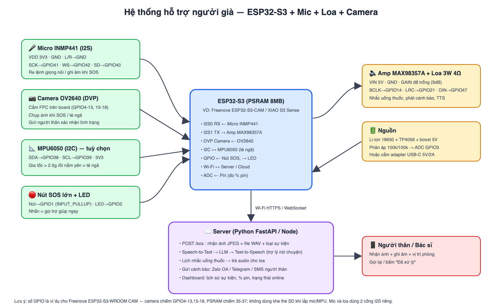

# ESP32-S3 hỗ trợ người già (Mic + Loa + Camera + SOS)



Nhấn nút SOS → ESP32 bíp → chụp ảnh + ghi âm 3s → POST `/sos` lên server → server gửi ảnh + ghi âm cho người thân qua Telegram → ESP32 bíp xác nhận.

## Phần cứng
- ESP32-S3 có PSRAM (Freenove ESP32-S3-WROOM CAM / XIAO ESP32S3 Sense) + camera OV2640
- Micro INMP441 (I2S): SCK 41, WS 42, SD 40
- Amp MAX98357A + loa 3W 4Ω: BCLK 14, LRC 21, DIN 47
- Nút SOS: GPIO1 (INPUT_PULLUP), LED: GPIO2
- MPU6050 (tuỳ chọn, phát hiện té ngã): SDA 38, SCL 39

Camera chiếm GPIO4-13, 15-18; PSRAM chiếm 35-37. Đổi chân nếu board khác.

## Chạy
**ESP32** — `esp32_elderly_care.ino`: Arduino IDE, core esp32 3.x, board *ESP32S3 Dev Module*, PSRAM *OPI PSRAM*. Sửa `WIFI_SSID`, `WIFI_PASS`, `SERVER`.

**Server** — `server.py`:
```bash
pip install fastapi uvicorn python-multipart requests
TG_TOKEN=<bot token> TG_CHAT=<chat id> uvicorn server:app --host 0.0.0.0 --port 8000
```

## Mở rộng
- Té ngã: đọc MPU6050, |a| > 2.5g rồi nằm yên 2s → `postSOS("fall")`
- Trợ lý giọng nói: Speech-to-Text → LLM → Text-to-Speech, tham khảo [xiaozhi-esp32](https://github.com/78/xiaozhi-esp32)

## Tài liệu
- [esp32-camera](https://github.com/espressif/esp32-camera)
- [Arduino-ESP32 I2S](https://docs.espressif.com/projects/arduino-esp32/en/latest/api/i2s.html)

> Code mẫu chưa test trên phần cứng thật — kiểm tra lại chân theo board của bạn.
