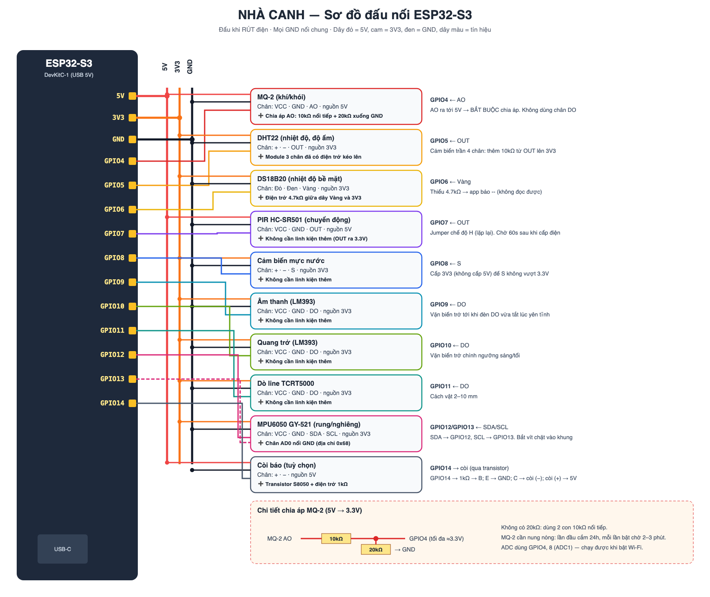

# NHÀ CANH — Hướng dẫn đấu nối chi tiết (ESP32-S3)



Chân khớp với firmware [`esp32/nha_canh.ino`](esp32/nha_canh.ino). **Luôn rút USB khi cắm/rút dây.**

## 1. Chuẩn bị
| Vật tư | Số lượng |
|---|---|
| ESP32-S3 DevKitC-1 (hoặc board S3 tương tự) + cáp USB-C có truyền dữ liệu | 1 |
| Breadboard 830 lỗ + dây đực-đực, đực-cái | 1 bộ |
| Điện trở 10kΩ | 2 (chia áp MQ-2) + 1 (DHT22 trần nếu cần) |
| Điện trở 20kΩ (hoặc thêm 2 con 10kΩ) | 1 |
| Điện trở 4.7kΩ | 1 (DS18B20) |
| Transistor S8050 / 2N2222 + điện trở 1kΩ + còi chủ động 5V | 1 bộ (tuỳ chọn) |

## 2. Thanh nguồn trên breadboard
1. Chân **5V** của ESP32 → hàng **đỏ** bên trái breadboard.
2. Chân **3V3** → hàng **đỏ** bên phải (dán băng dính ghi "3V3" để khỏi nhầm).
3. Chân **GND** → **cả hai** hàng xanh/đen (nối 2 hàng GND với nhau).

> 5V chỉ dùng cho MQ-2, PIR và còi. Mọi cảm biến khác dùng 3V3 để tín hiệu ra không vượt 3.3V (ESP32-S3 **không chịu được 5V** ở chân GPIO).

## 3. Bảng đấu từng cảm biến
| # | Module | Nguồn | GND | Chân tín hiệu → ESP32 | Linh kiện thêm |
|---|---|---|---|---|---|
| 1 | MQ-2 | VCC → **5V** | GND | **AO → 10kΩ → GPIO4**, và GPIO4 → 20kΩ → GND | Bắt buộc chia áp. Bỏ trống DO |
| 2 | DHT22 (module 3 chân) | + → 3V3 | − | OUT → **GPIO5** | Loại trần 4 chân: 10kΩ từ chân data lên 3V3, chân 3 bỏ trống |
| 3 | DS18B20 chống nước | Đỏ → 3V3 | Đen | Vàng → **GPIO6** | **4.7kΩ** giữa Vàng và 3V3 |
| 4 | PIR HC-SR501 | VCC → **5V** | GND | OUT → **GPIO7** | Không cần (OUT ra 3.3V). Jumper để H |
| 5 | Cảm biến mực nước | + → 3V3 | − | S → **GPIO8** | Không cần |
| 6 | Cảm biến âm thanh | VCC → 3V3 | GND | DO → **GPIO9** | Không cần |
| 7 | Cảm biến quang (LDR) | VCC → 3V3 | GND | DO → **GPIO10** | Không cần |
| 8 | Dò line TCRT5000 | VCC → 3V3 | GND | DO → **GPIO11** | Không cần |
| 9 | MPU6050 (GY-521) | VCC → 3V3 | GND | SDA → **GPIO12**, SCL → **GPIO13** | AD0 → GND. INT, XDA, XCL bỏ trống |
| 10 | Còi (tuỳ chọn) | Còi (+) → **5V** | E của S8050 → GND | **GPIO14 → 1kΩ → B**; C → còi (−) | Còi module 3.3V có chân I/O: cắm thẳng I/O → GPIO14 |

### Chia áp MQ-2 (quan trọng nhất)
```
MQ-2 AO ──[10kΩ]──┬── GPIO4      (5V × 20/30 ≈ 3.3V)
                  └──[20kΩ]── GND
```

### Còi qua transistor S8050 (mặt phẳng có chữ hướng về mình: E – B – C)
```
GPIO14 ──[1kΩ]── B
                 E ── GND
5V ── còi(+)  còi(−) ── C
```

## 4. Thứ tự lắp và kiểm tra (lắp 1 cái, thử 1 cái)
1. Chỉ cắm ESP32, nạp firmware (sửa `WIFI_SSID`, `WIFI_PASS`), mở Serial Monitor 115200 → ghi lại **IP**.
2. Mở `http://<IP>/api` trên trình duyệt điện thoại (cùng Wi-Fi). Thấy chuỗi JSON là đúng.
3. Lắp từng cảm biến theo bảng, sau mỗi cái tải lại trang `/api` và so với bảng dưới:

| Cảm biến | Trường JSON | Giá trị đúng | Thử bằng cách |
|---|---|---|---|
| DHT22 | `t`, `h` | ~25–35, ~40–90 | Hà hơi vào → `h` tăng |
| DS18B20 | `td` | ~nhiệt độ phòng | Nắm đầu dò → tăng. `null` = thiếu 4.7kΩ hoặc sai dây |
| MQ-2 | `mq` | 200–800 khi sạch | Lần đầu chờ nóng 2–3 phút. **Không** thử bằng lửa/gas |
| Mực nước | `water` | ~0 khi khô | Nhúng vào cốc nước → tăng |
| PIR | `pir` | 0 → 1 khi vẫy tay | Chờ 60s sau khi cấp điện |
| Âm thanh | `snd` | 0/1 | Vỗ tay; chỉnh biến trở |
| Quang / dò line | `light`, `line` | 0/1 | Che tay; chỉnh biến trở |
| MPU6050 | `mpu` | ~0.00–0.05 khi đứng yên | Lắc board → tăng. Luôn 0 = sai SDA/SCL hoặc thiếu nguồn |

4. Cuối cùng mở app NHÀ CANH → ⚙ Cài đặt → tắt mô phỏng → nhập IP → **Thử kết nối**.

## 5. Lỗi hay gặp
| Hiện tượng | Nguyên nhân thường gặp |
|---|---|
| Board nóng, tự khởi động lại | Chập 5V với 3V3/GND; nhiều module 5V dùng nguồn USB yếu → dùng cục sạc 5V 2A |
| `mq` luôn 4095 | Quên chia áp (nguy hiểm cho chân GPIO4) hoặc AO chạm 5V |
| `t`, `h` = null | Sai chân DHT22 hoặc đọc nhanh hơn 2 giây |
| Không vào được `/api` | Điện thoại khác Wi-Fi, Wi-Fi 5GHz (ESP32 chỉ chạy 2.4GHz), sai IP |
| App báo mất kết nối dù trình duyệt vào được | Chưa bật mạng cục bộ cho app; thử tắt 4G/VPN |
| Cảm biến mực nước bị gỉ sau vài ngày | Bình thường với loại tấm đồng; khi thi xong rửa và lau khô |

## 6. An toàn
- Không nối bất kỳ chân tín hiệu 5V nào thẳng vào ESP32-S3.
- MQ-2 nóng khi chạy, đặt cách xa dây và vỏ nhựa mỏng.
- Hệ thống dùng để học tập, **không thay thế** thiết bị báo cháy/CO đạt chuẩn.
