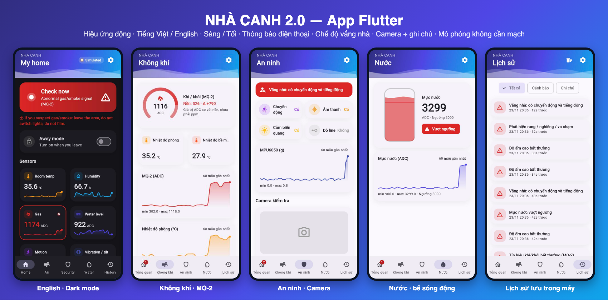

# NHÀ CANH 2.0 — App Flutter (bản hoàn chỉnh)



**Tải APK:** [Releases](https://github.com/CaoLP/Sample-Projects/releases/tag/nhacanh-app-v2.0.0). Đa số điện thoại dùng bản `arm64`, máy cũ dùng `armv7`.

Thay cho `android/MainActivity.kt`. Đọc **cùng JSON** từ firmware `esp32/nha_canh.ino` (`GET http://<IP>/api`), không cần sửa mạch.

## Có gì
| Phần | Nội dung |
|---|---|
| Mở đầu | Logo ngôi nhà nảy + sóng động, chọn VI / EN |
| Tổng quan | Thẻ trạng thái lớn (xanh "Nhà đang an toàn" / đỏ "Cần kiểm tra ngay"), công tắc **vắng nhà**, 6 cảm biến có biểu đồ nhỏ, thẻ nào vượt ngưỡng thì viền đỏ nhấp nháy |
| Không khí | Đồng hồ MQ-2 so với **giá trị nền tự hiệu chuẩn** (trung bình 10 mẫu đầu), nhiệt độ phòng/bề mặt, biểu đồ 60 mẫu có min/max/ngưỡng |
| An ninh | PIR, âm thanh, quang, dò line; biểu đồ MPU6050; banner đỏ khi vắng nhà mà có chuyển động + tiếng động; **chụp ảnh bằng camera** + ghi chú |
| Nước | Bể nước có mặt sóng động, vạch ngưỡng đỏ, biểu đồ |
| Lịch sử | Lưu trong máy (giữ khi tắt app), lọc Cảnh báo / Ghi chú, xoá có hỏi lại |
| Cài đặt | Ngôn ngữ, giao diện tối, bật/tắt thông báo, chế độ mô phỏng, IP ESP32 + nút **Thử kết nối** |

- **Thông báo điện thoại** + rung khi có cảnh báo mới. Cùng một cảnh báo chỉ báo lại sau 2 phút (tránh spam khi cảm biến dao động quanh ngưỡng).
- **Mô phỏng** (mặc định bật) chạy kịch bản ~2 phút: bình thường → khói bếp (MQ-2 + nhiệt tăng) → nước dâng → có người lạ (rung + chuyển động + tiếng động). Dùng để demo khi không mang mạch.
- Ngưỡng giống bản Kotlin, ở đầu `lib/state.dart`: `mqDelta 400, tempMax 50, humMax 85, waterMax 3000, mpuMax 0.5`. **Phải chỉnh theo đo thực tế.**

## Cấu trúc
```
lib/main.dart     app, theme, màn hình mở đầu, thanh điều hướng
lib/screens.dart  5 tab + cài đặt
lib/widgets.dart  sóng nước, đồng hồ, biểu đồ, điểm nhấp nháy, hiệu ứng vào màn hình
lib/state.dart    đọc /api, mô phỏng, ngưỡng + cảnh báo, lịch sử, thông báo
lib/i18n.dart     bảng tiếng Việt / English
```

## Chạy / build
```bash
flutter pub get
flutter run
flutter build apk --release --split-per-abi
```
Manifest đã có sẵn INTERNET, POST_NOTIFICATIONS, `usesCleartextTraffic="true"` (ESP32 dùng http).

## Lưu ý
- Điện thoại và ESP32 phải **cùng Wi-Fi**.
- Thông báo chỉ chạy khi app đang mở hoặc chạy nền gần đây (chưa có service chạy nền 24/7). Còi tại chỗ GPIO 14 do firmware tự điều khiển.
- MQ-2 là **tín hiệu ADC**, không phải ppm. App hỗ trợ, **không thay thế** thiết bị báo cháy/CO đạt chuẩn. Không thử MQ-2 bằng cách đốt hay xả gas.
